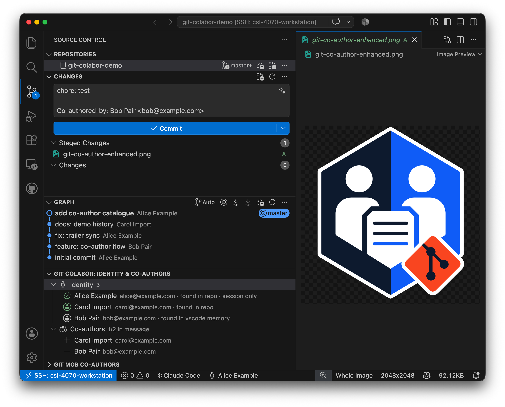
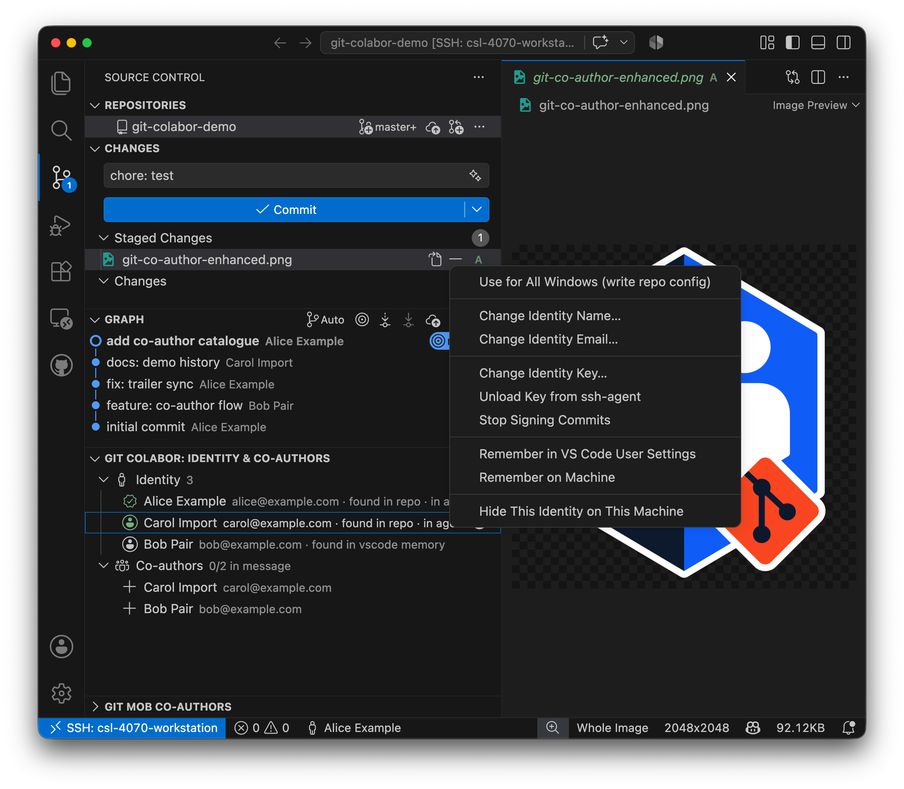
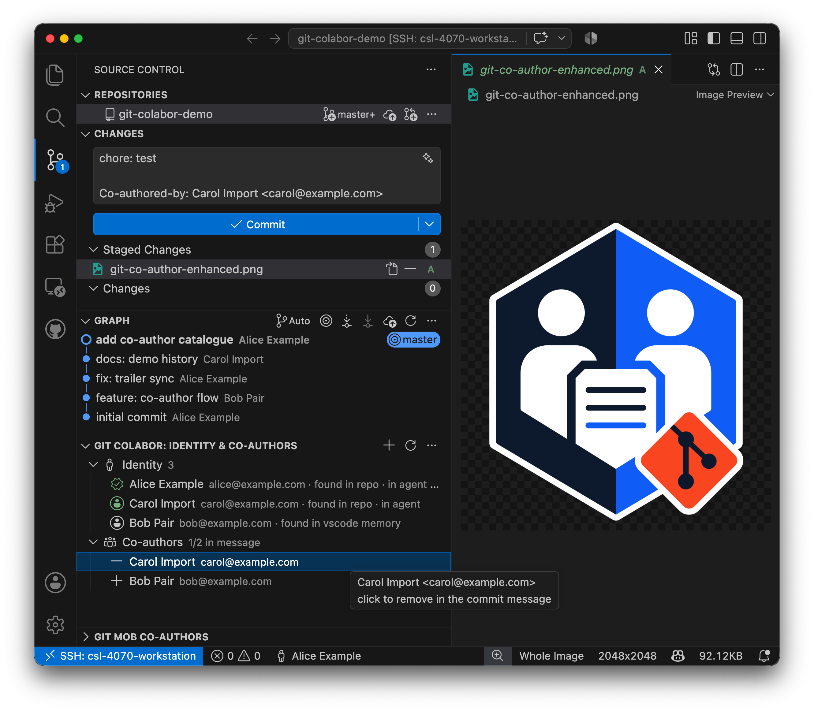
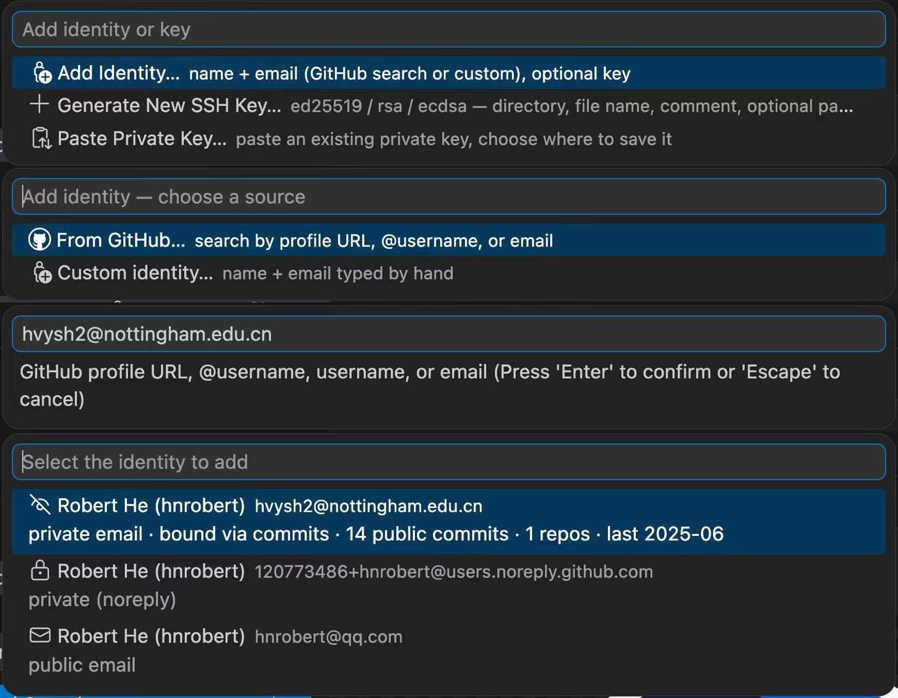

# Git Colabor

[](https://marketplace.visualstudio.com/items?itemName=HNRobert.vscode-git-colabor)
[](https://marketplace.visualstudio.com/items?itemName=HNRobert.vscode-git-colabor)
[](https://open-vsx.org/extension/HNRobert/vscode-git-colabor)
[](LICENSE)
[](https://github.com/hnrobert/vscode-git-colabor/issues)
[](https://github.com/hnrobert/vscode-git-colabor/issues?q=is%3Aissue+is%3Aclosed)

<p align="center"></p>

> A VS Code extension + CLI that switches the Git **committer + pusher identity** and **SSH key** per repository, and manages **co-authors** with a better experience — built for shared machines, multiple accounts, Remote-SSH, Codespaces, and dev containers.



## Why

Git gives you exactly one global identity per clone — `user.name`, `user.email`, one `ssh-agent`. That breaks the moment you:

- **share a machine** (workstation, lab box, pairing rig) and commits start landing under the wrong person;
- **have several accounts** (work / personal / student), each with its own SSH key, and the wrong one only fails at push time;
- **develop remotely**, where the repo and agent live workspace-side and local tools can't help;
- **pair**, and want `Co-authored-by:` trailers without hand-editing every commit message.

Git Colabor treats identity as explicit, per-repo, **reversible and auditable** state: pick an identity in the SCM view, commit, push, and `revert` the repo to its exact prior config when you leave. Select a co-author once and every commit message carries the trailer until you go solo.

## Features

- **Identities** — name / email / SSH key profiles; applying one writes `user.name`, `user.email`, `core.sshCommand` and snapshots prior config for one-command revert. Applies to **every repo open in the window**; keys enter `ssh-agent` only through the explicit right-click action.
  - 
- **Layered use, explicitly** — the default Use action follows `gitColabor.useTarget` (this window via git env injection, repo config, or global config); the right-click menu always names its target: *Use in this session* / *Use & write git repo config* / *Use & write git global config*, and *Unset in git repo/global config* strips an identity from that file. Identities named by the repo or global git config show in the list as "found in repo config" / "found in git global config".
- **Opt-in commit signing (SSH or GPG)** — right-click an identity → *Sign Commits with SSH Key…* (picker lists the identity's own auth key first, then store keys, `~/.ssh`, and global-config keys) / *Sign Commits with GPG Key…* (green account icon = has a key; the active identity shows a plain green check while commits sign with its key — the verified badge lives on the Signing row); never on by default — but it IS remembered per identity: once turned on for an identity, switching away and back re-enables signing automatically (Stop Signing drops the preference). The sign key is a per-identity preference stored separately from the push key, so signing with another SSH key never changes what you push with — and the picker lists keys from your store, `~/.ssh`, and even the global git config. Signing follows the identity's layer (this window, or the repo/global config it was written to); switching to a key-less identity turns signing off automatically (pinning `commit.gpgsign=false` over an inherited key) — or asks first via `gitColabor.signingMismatchAction: warn`, and *Stop Signing Commits* really stops — it overrides a `commit.gpgsign=true` inherited from `~/.gitconfig` instead of falling back to it. The **Signing** row shows what `git commit` will actually do and where it comes from (this window / repo config / global / system), and warns when the key is not the active identity's.
- **History import** — every committer **and every `Co-authored-by:` trailer author** in the repo's history becomes an identity automatically ("found in repo history"); hide the ones you don't want on this machine.
- **Co-authors** — every identity is a potential co-author; trailers seeded into the commit template **and** kept in sync with the SCM commit input box — click `+`/`-` on a row and the commit message follows. Right-click → *Always Include* pins a co-author for **every repo in this window** (git-mob style — each repo's selection is written and kept in sync; repos opened later catch up automatically; Solo clears); *Stop Always Including* releases them everywhere in the window.
  - 
- **Add Identity / Key wizard** — the view-title `+` opens one integrated menu: add an identity, generate a fresh key, or paste an existing private key — without leaving the editor.
  - **From GitHub**: paste a profile URL, `@handle`, login, or email — even a *private* one. Git Colabor resolves the account through commit attribution and offers every usable address: the searched private email (with public-commit evidence), the verified public profile email, and the `noreply` form.
    - 
  - **Generate a key**: pick type (ed25519 / rsa / ecdsa), directory, file name, comment (defaults to `user@host`), and an optional passphrase — fed through `SSH_ASKPASS`, never on `argv`, never on disk.
  - **Paste a key**: drop an existing private key into an editor pane, choose where it lives; the file is written `0600` and referenced in place.
- **Safe key handling** — keys are referenced in place (never copied or modified); passphrases live in session memory only (never on disk) and reach `ssh-add` over a UNIX-socket askpass bridge — never on `argv`, never in `ps`, never in logs. Loading a key into ssh-agent is an explicit right-click action. A broken key reference degrades to a key-less apply.
- **Multi-session coordination** — advisory `heldBy` locking warns before one window/terminal overrides another's identity.
- **Audit trail** — every identity change logged locally (fingerprint only) with repo / host / user / source.
- **Truly remote-friendly** — the extension spawns the bundled CLI with the VS Code Server's own Node; nothing depends on remote `$PATH`.
- **The CLI is the engine** — everything the UI does is scriptable via `git colabor …` ([CLI reference](packages/git-colabor/README.md)), including `--json` output and stable exit codes.

## Install

Install from the [VS Code Marketplace](https://marketplace.visualstudio.com/items?itemName=HNRobert.vscode-git-colabor) or [OpenVSX](https://open-vsx.org/extension/HNRobert/vscode-git-colabor):

```bash
code --install-extension HNRobert.vscode-git-colabor
```

Or build the latest from source:

```bash
git clone git@github.com:hnrobert/vscode-git-colabor.git
cd vscode-git-colabor
pnpm install && pnpm build   # workspace installs both packages
pnpm package          # → git-colabor-<version>.vsix
```

Then in VS Code: *Extensions → ⋯ → Install from VSIX…*

**Requirements:** VS Code ≥ 1.83. For terminal use of the standalone CLI: Node.js ≥ 24 (the extension itself bundles everything).

## Quick start

1. **Add identities** — Command Palette → `Git Colabor: Add Identity…` (name, email, optional private key — picked from a scan of `~/.ssh` or typed).
2. **Use one** — SCM view → *Git Colabor: Identity & Co-authors* → click an identity (or the status-bar item). The repo's `user.*` / `core.sshCommand` switch; an encrypted key prompts for its passphrase once per session (verify-only, no agent write). To cache the key in ssh-agent, right-click the identity → **Load Key into ssh-agent**.
3. **Pair** — the *Co-authors* list shows `+` next to everyone not yet in the commit message; click to append their `Co-authored-by:` trailer (the `+` flips to `-`; click again to remove). The markers follow what you type in the message box.
4. **Leave clean** — `Logout Identity` clears the repo's git-config layer (with a scope confirmation) and unloads the key from `ssh-agent` (your key files are never touched).

## Commands

| Command | Effect |
| --- | --- |
| `Use Identity…` | Pick an identity to apply to the current repo |
| `Add Identity…` / `Remove Identity…` / `Logout Identity` | Manage identities (key files are referenced, never deleted); right-click rows to change name/email/key, load or remove the key in ssh-agent, toggle signing, save to memory, or hide imported ones |
| `Select Co-authors…` / `Add Co-author…` / `Solo (clear co-authors)` | Co-author selection (the tree's +/- rows toggle the commit message directly) |
| `Show Audit Log` | Last 100 audit entries as JSONL |
| `Doctor` | Self-check (binaries, map, agent, repo markers) |
| `Reload` | Refresh the view (also automatic on terminal-CLI changes) |

## Settings

| Setting | Default | Effect |
| --- | --- | --- |
| `gitColabor.defaultIdentity` | `""` | Identity auto-activated when a repo opens with none active. Resolves exactly like `identity use` — **alias first**, then email; a shared email pops a picker, no match = no change. Fresh repos only |
| `gitColabor.cliPath` | `""` | Override the bundled CLI path (`resources/cli.cjs`) |
| `gitColabor.rememberedIdentities` | `[]` | **Remembered identities** — `"Name <email>"` entries in your VS Code settings (right-click an identity → *Remember on VS Code User Settings*); remembered rows show in every repo and feed the Co-authors list. |
| `gitColabor.autoApplyOnRepoOpen` | `true` | Auto-apply the config-derived active identity (or `gitColabor.defaultIdentity` on a fresh repo) when a repo opens; off = only explicit *Use* writes config |
| `gitColabor.conflictWarningStaleMinutes` | *unset* | Advisory `heldBy` staleness threshold (minutes); **unset = a session lock never goes stale** |
| `gitColabor.githubFetch` | `true` | Offer the GitHub user search (*Add Identity → From GitHub…*); hits `api.github.com` unauthenticated (60 req/h) |
| `gitColabor.postCommitSolo` | `false` | Clear the selected co-authors after each commit (dual watch on `COMMIT_EDITMSG` + the reflog — aborted editor saves and checkouts never trigger it) |
| `gitColabor.keyPromptCancel` | `cancel` | Behavior when cancelling a key passphrase prompt at use time: `cancel` aborts the whole application; `degrade` applies the identity without the key |
| `gitColabor.logoutAgentKey` | `ask` | Logout with the key loaded in ssh-agent: `ask` (Yes/No dialog — dismissing aborts the logout, "Always…" stores the choice) / `remove` / `keep`; the key file is never touched |
| `gitColabor.signingMismatchAction` | `auto` | After switching identities, when the new identity would sign with a foreign key: `auto` (keyed → rebind to its key, key-less → off, silent) or `warn` (dialog: keep / switch / stop) |
| `gitColabor.useTarget` | `session` | Which config layer the default Use action writes (row click / *Use Identity…*): `session` (this window only), `repo`, or `global`; the right-click items always name their target |
| `gitColabor.logLevel` | `info` | Output channel log level: `trace` / `debug` / `info` / `warning` / `error` / `off` |

## Security

- Private keys are referenced in place — never copied, modified, or deleted by the tool; a missing key file degrades the identity to key-less with a warning.
- Passphrases are session-scoped (extension memory, never on disk) and delivered to `ssh-add`/`ssh` through a per-session `0600` UNIX socket with a constant-time-compared token.
- The audit log records fingerprints only — never key bodies or passphrases (pinned by unit + e2e tests).

Threat model, protocol details, and explicit non-guarantees: [docs/SECURITY.md](docs/SECURITY.md).

## FAQ

**Remote-SSH / Codespaces / dev containers?** Yes — all git/SSH logic runs in the CLI workspace-side; the extension just drives it.

**What if I stop using it?** `Logout Identity` clears the repo-local `user.*` / `core.sshCommand` / signing keys (content-matched, with a scope confirmation when global config is involved). Nothing global is left behind except an optional `commit.template` it set only if you had none.

**Windows?** Supported (config under `%APPDATA%\git-colabor`, `icacls` key permissions). The askpass socket requires the UNIX-socket support in your Node/Windows build.

## Documentation

| Doc | Contents |
| --- | --- |
| [docs/ARCHITECTURE.md](docs/ARCHITECTURE.md) | Module map, data flow, JSON bridge & askpass protocol |
| [docs/SECURITY.md](docs/SECURITY.md) | Threat model, key/passphrase handling, non-guarantees |
| [docs/DEVELOPMENT.md](docs/DEVELOPMENT.md) | Build, test, packaging, publishing |
| [git-colabor/README.md](git-colabor/README.md) | Standalone CLI (`git colabor …`) command reference |
| [CONTRIBUTING.md](CONTRIBUTING.md) | Workflow |

## Development

```bash
pnpm install && pnpm -C packages/git-colabor install
pnpm build && pnpm typecheck && pnpm lint && pnpm test
```

F5 launches an Extension Development Host. Full guide: [docs/DEVELOPMENT.md](docs/DEVELOPMENT.md).

## License

[Apache-2.0](LICENSE)

## Acknowledgements

Inspired by [git-mob](https://github.com/rkotze/git-mob) — the co-author selection model (pick your pairing partners once, every commit carries the trailers until you go solo) and the commit-template rewrite semantics come from it.
